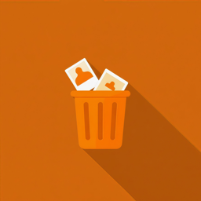
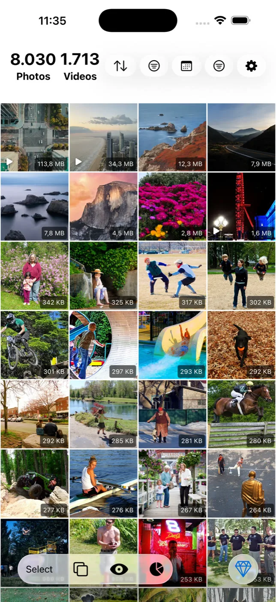
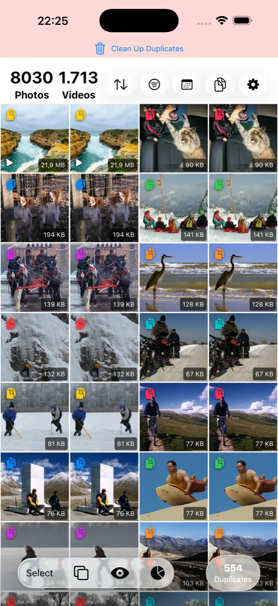
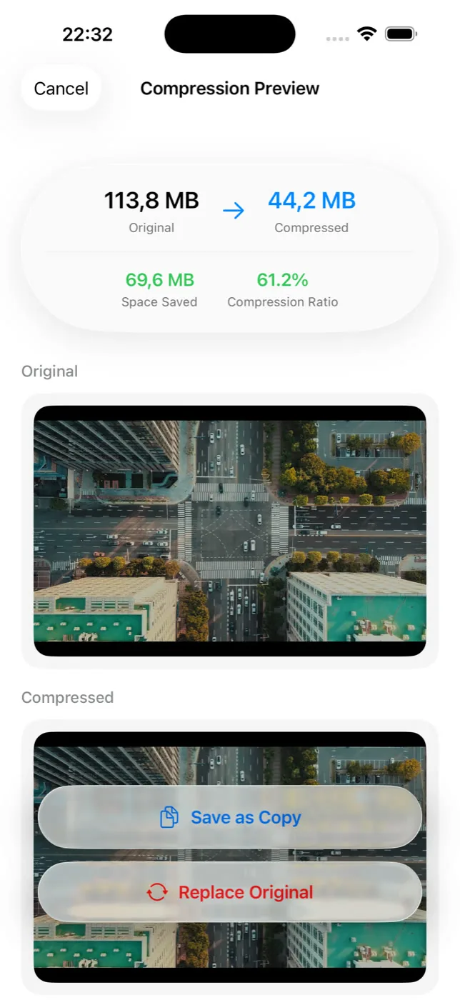
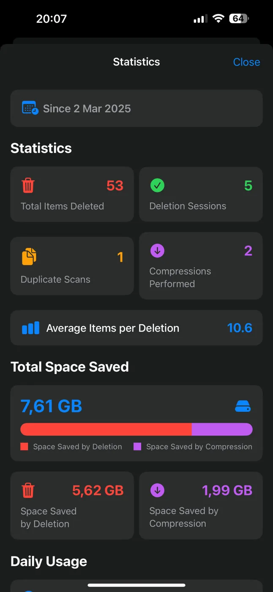

  

<h1 align="center">Slean</h1>

  A photo and video cleaner for iPhone and Android that runs on your device. 
  Find duplicates, sort by size, compress, and free up space.

  <a href="https://apps.apple.com/app/apple-store/id6740009265?pt=127535878&ct=github&mt=8">App Store</a> ·
  <a href="https://play.google.com/store/apps/details?id=com.emreertunc.slean&referrer=utm_source%3Dgithub%26utm_campaign%3Dslean-readme">Google Play</a> ·
  <a href="https://slean.app">slean.app</a>

  
  
  
  

## What it does

- **Sort by file size**, largest first, across the whole library or inside any filter.
- **Find duplicates** of photos and videos and group them for review.
- **Group near-identical photos**, such as bursts and retakes, so you keep one.
- **Filter** by screenshot, favourite, media type, size range, date range and album.
- **Review full screen** with date, size and file type before anything is deleted.
- **Delete in bulk**, scoped to the current album or filter.
- **Compress** photos and videos with a size preview before saving.
- Crop, rotate, resize, collage, and **Pixel Stretch** effects.
- **On This Day** and cleanup statistics.

## Privacy

Sorting, scanning, duplicate and similar-photo detection, filtering and compression run on the device. Your library is not uploaded for these features. There is no account, no sign-in, no ads and no advertising SDKs.

The optional AI photo editor is the one exception: it needs to send the photo you choose to edit to an AI service. Everything else stays local.

Privacy policy: [slean.app/privacy-policy](https://slean.app/privacy-policy)

## Scope

- Slean works on the photo library only. It does not clean app caches or system files, and it makes no speed or battery claims.
- Slean is not a backup tool. Back up photos you cannot replace before a large cleanup.

## Platforms

- iPhone and iPad, iOS 15.0 or later. Native, built with Swift and SwiftUI.
- Android 8.0 or later. Native, built with Kotlin and Jetpack Compose.
- 14 languages in the app.

Free to install on the App Store and Google Play.

## Learn more

- [How Slean finds duplicate and similar photos](https://slean.app/duplicate-vs-similar-photos)
- [Best photo cleaner for iPhone: comparison](https://slean.app/compare/best-photo-cleaner-for-iphone)
- [Guides](https://slean.app/guides)

## Contact

Built by [Emre Ertunç](https://slean.app/about). Questions and bug reports: emre@ertunc.com
